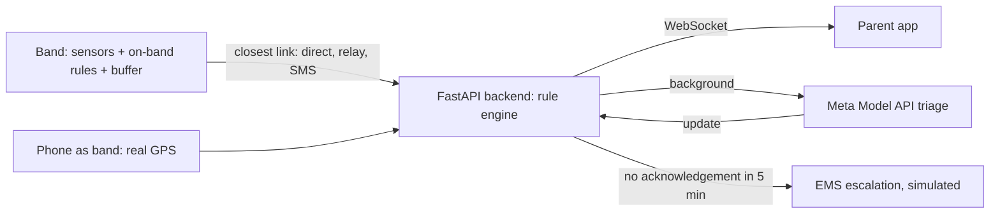

# SafeSteps

**An ankle or waist band that tells a parent or trusted contact within seconds when something is wrong, even where there is no signal.**
Built for the Meta Global AI Developer Hackathon (26 Oct to 4 Nov 2026). Author: Gerald Magoro.

## The problem

In many South African schools children are not allowed to carry phones, so a child walking to school has no way to call for help and a parent has no way to know. The same gap affects adults: someone going to meet a stranger can lose their phone first, and a phone is the first thing taken from a person in danger.

SafeSteps is a small body-worn band (ankle for a child, waist under clothing for an adult) that watches skin contact, heart rate, location and water, runs its safety rules on the band itself, and keeps working when there is no internet.

> Low cost is a design goal so it can reach as many families as possible. **No costed bill of materials exists yet**, so this project makes no price claim.

## What is built, and what is simulated

| Area | Status |
|---|---|
| Rule engine, live alerts, acknowledge, 5-minute escalation timer | Built |
| Meta Model API triage with tool calls, parent-language message | Built |
| Offline store-and-forward: band buffers, flushes via nearest link | Built |
| Parent app (setup, offline route map, vitals, alert screen) | Built |
| One-click demo scenarios, no terminal needed | Built |
| Phone as the band (real GPS, simulated heart rate and skin sensor) | Built |
| Access PIN on every data endpoint | Built (single shared PIN) |
| Personal baseline: Meta Model proposes, server limits, parent approves | Built (demo history is **synthetic**) |
| Automated tests (rules, baseline, PIN, AI client) | Built (38 tests) |
| Baseline learned from real trip logs | Roadmap, not built |
| Band hardware, heart-rate and skin sensors | **Simulated** |
| SMS fallback, ambulance (EMS) call | **Simulated** (written to a file or printed) |
| Nearby help list | **Sample data** (the demo never dials it) |
| Community mesh alert, audio and video bursts | Roadmap, not built |
| User accounts, encryption at rest, full privacy-law review | Roadmap, not built |

## How the Meta Model API is used

- Model: `muse-wonder-1.0` through the OpenAI-compatible chat completions endpoint (`https://api.meta.ai/v1`).
- **Alert triage agent** (`backend/ai.py`): after the rules raise an alert, the model is given tools (`get_recent_readings`, `get_child_profile`, `get_nearby_help`), calls them as needed, and returns a structured result: severity, confidence, likely-false-alarm flag, reasons, a plain message, and the same message in the parent's language.
- **Safety by design:** rules fire first and the parent is notified immediately. The model annotates an alert and can never cancel or delay it. If the API is unreachable, the rule-based alert stands.
- **Personal baseline** (`backend/baseline.py`): the model reads a child's recent trips and proposes a personal threshold for the one rule that causes false alarms (heart rate while still). Facts such as averages and ranges are computed in code, not by the model. The server clamps the proposal (never below what the child's own history supports, never above 150 bpm), and a parent must approve it. Band-off, drowning, faint and off-route rules are never personalised. The triage agent can also call `get_baseline` to judge whether an alert is out of character. The demo history is synthetic and labelled so.
- **Cost control:** the model runs only on alerts, repeat alerts of the same type are folded for 60 seconds, and `/ai/status` shows calls, tokens and an estimated cost.
- **Resilience:** automatic retries with back-off for flaky networks; `POST /ai/selftest` proves the key works.

## Architecture



## Quick start (Windows PowerShell)

```powershell
python -m venv .venv
.\.venv\Scripts\Activate.ps1
pip install -r backend\requirements.txt
cd parent-app; npm install; npx expo export --platform web; cd ..
$env:META_API_KEY = "<your key>"        # never commit keys
$env:SAFESTEPS_PIN = "<choose a PIN>"   # optional: protects the API
uvicorn backend.main:app --host 0.0.0.0 --port 8000
```

Open `http://localhost:8000`. See `RUN-DEMO.md` for the demo, the public link and the phone-as-band page (`/band`).

Tests: `pip install -r requirements-dev.txt` then `pytest`.

## Detection rules

| Alert | Trigger |
|---|---|
| `skin_off` | skin gap above 2.5 cm |
| `hr_spike_no_movement` | heart rate above 130 bpm and under 2 m movement |
| `possible_faint` | heart rate below 50 bpm and under 2 m movement |
| `possible_drowning` | depth above 100 cm for over 30 s, heart rate above 130, under 1 m movement |
| `off_route` | more than 15 m (`SAFESTEPS_OFF_ROUTE_M`) from the route for 5 minutes |
| `early_departure` | movement before 06:00 local (`SAFESTEPS_EARLIEST_HOUR`) |

Heart rate alone is a weak signal, which is why triage, parent acknowledgement and the personal baseline exist. False alarms are the main technical risk. Trade-off of a personal baseline: a real spike between the default and the personal threshold would not alert, which is why the parent decides and the threshold has a hard cap.

## Privacy and safety principles

- The wearer or guardian controls who is notified. This must never become covert tracking of another adult.
- Saved logs round coordinates to about 100 m; the live alert to the contacts is exact.
- The demo uses placeholder contacts and never dials a real number.
- No real children's data is used or stored in this repository. Runtime data files are git-ignored.
- The shared PIN is a demo-grade gate. Real deployment needs accounts, encryption at rest and a privacy-law review.

## Demo

1. **Parent tab:** Skip setup loads the demo profile (Naledi). The map is an offline drawing, no map tiles.
2. **Live demo tab:** Play demo runs a scripted band through the real backend. "Dead zone, then nearest relay" shows the band's local alarm, offline buffering, the relay flush, the alert and the Meta triage.
3. **Baseline tab:** load the synthetic history, run the Meta Model analysis, approve, then play "runner at the crossing" before and after to see the false alarm disappear while the safety rules stay unchanged.
4. **Phone as band:** open `/band` on a phone (over the https public link), press Start band, fit the route where you stand, then walk. Heart rate and skin contact are controlled by buttons.

## API (data endpoints need the PIN header `x-pin` when `SAFESTEPS_PIN` is set)

| Method | Path | Purpose |
|---|---|---|
| POST | `/ingest`, `/ingest/batch` | Band reading, or a buffered batch |
| GET | `/children/{id}/status` | Latest reading, trail, status |
| GET, POST | `/route`, `/route/rebase`, `/route/reset` | Expected route |
| POST | `/alerts/{id}/ack` | Acknowledge an alert |
| WS | `/ws/alerts` | Live alerts and AI updates |
| GET, POST | `/ai/status`, `/ai/selftest` | Meta Model usage and key check |
| GET, POST | `/demo/scenarios`, `/demo/status`, `/demo/play` | One-click demo |
| GET, POST | `/baseline/{id}`, `/baseline/{id}/seed`, `/analyze`, `/approve`, `/reset` | Personal baseline |
| GET | `/health`, `/auth/check`, `/band` | Public |

## Built during the hackathon

The repository was started on 26 Oct 2026 or later and the commit history shows the work. The code was developed with the help of an AI coding assistant (Claude, by Anthropic) under the author's direction; the idea, design decisions, testing and demo are the author's.

## Roadmap

Real band hardware; baselines learned from real trip logs; accounts and encryption; SMS gateway; community relays; audio and video bursts; reviewing handling of personal data under South Africa's Protection of Personal Information Act.
